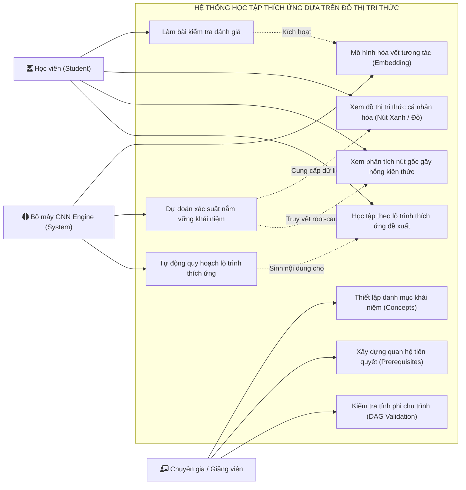
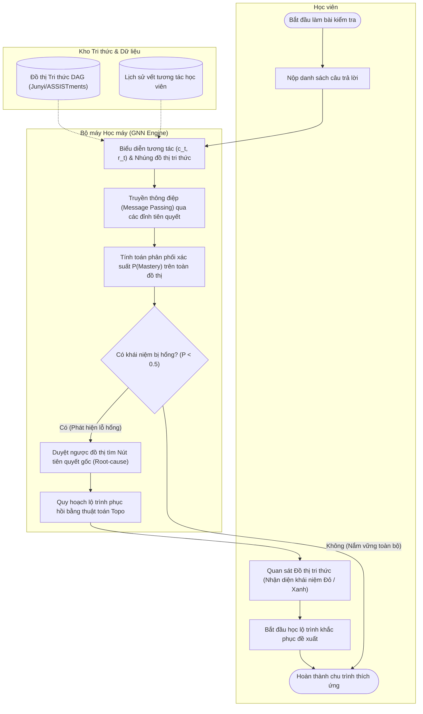
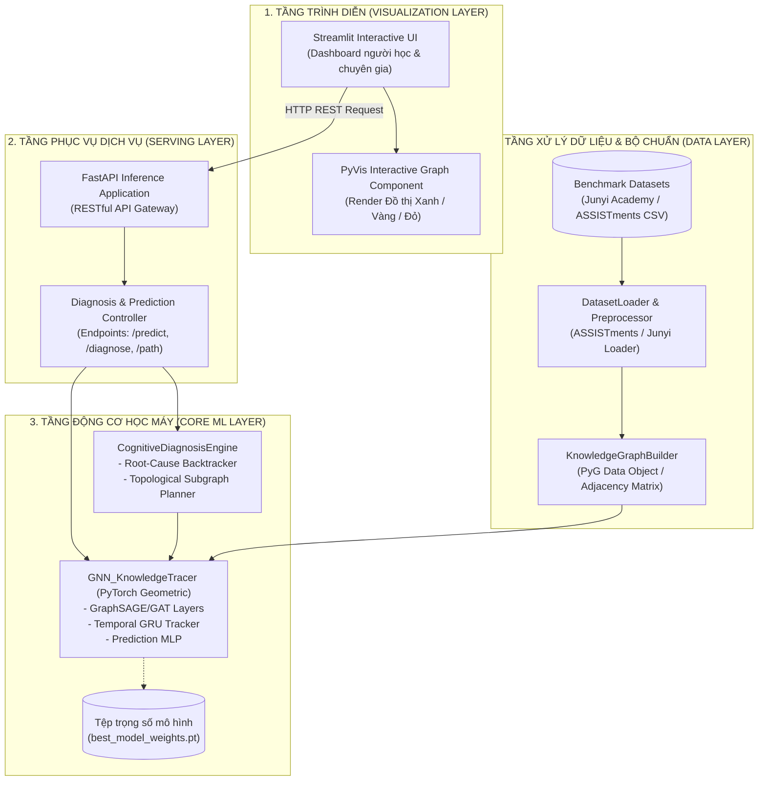
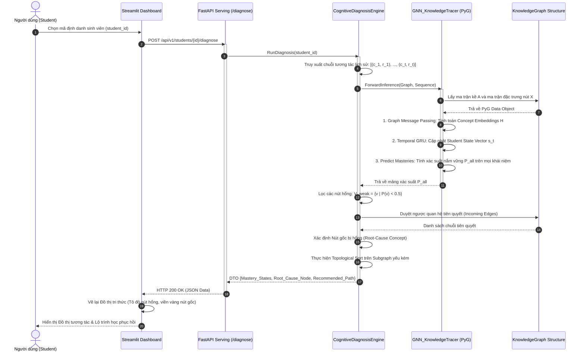
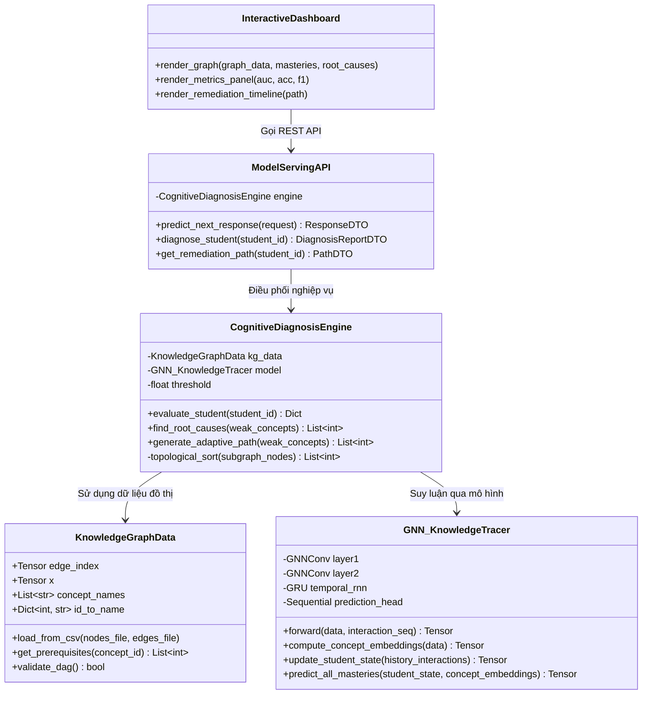

# PHÂN TÍCH THIẾT KẾ HỆ THỐNG HỌC TẬP THÍCH ỨNG DỰA TRÊN ĐỒ THỊ TRI THỨC VÀ MẠNG NƠ-RON ĐỒ THỊ (GNN)

---

## I. PHÂN TÍCH THIẾT KẾ NGHIỆP VỤ (BUSINESS ANALYSIS & DESIGN)

### 1. Phân tích nghiệp vụ (Business Analysis)

#### 1.1. Bối cảnh và phát biểu bài toán
Trong các hệ thống học tập truyền thống, việc đánh giá năng lực người học thường dừng lại ở việc chấm điểm cơ học (tính tổng điểm hoặc phần trăm câu đúng). Cách tiếp cận này bỏ qua sự phụ thuộc logic giữa các mảng kiến thức, dẫn đến tình trạng học viên không hiểu tại sao mình sai và phải ôn luyện dàn trải không trọng tâm.

Bài toán nghiên cứu thuộc lĩnh vực **Mô hình hóa Tri thức Người học (Knowledge Tracing - KT)** và **Chẩn đoán Nhận thức (Cognitive Diagnosis - CD)**:
* **Đầu vào nghiệp vụ:**
  * Cấu trúc tri thức môn học được chuẩn hóa dưới dạng **Đồ thị Tri thức (Knowledge Graph - KG)** biểu diễn các khái niệm và mối quan hệ tiên quyết (Prerequisite).
  * Vết tương tác học tập theo thời gian của học viên (chuỗi các lần làm bài tập, kết quả đúng/sai).
* **Mục tiêu nghiệp vụ:**
  * Dự đoán chính xác trạng thái nắm vững từng khái niệm của học viên.
  * Truy vết nguyên nhân gốc rễ (Root-cause Diagnosis): Xác định khái niệm nền tảng bị hổng gây ra chuỗi lỗi sai ở các bài học nâng cao.
  * Tự động tái cấu trúc và đề xuất lộ trình học tập thích ứng (Adaptive Learning Path) tối ưu theo thứ tự topo nhằm khắc phục lỗ hổng với chi phí thời gian thấp nhất.

#### 1.2. Các thực thể nghiệp vụ cốt lõi
* **Khái niệm tri thức (Knowledge Concept / KC):** Đơn vị kiến thức nguyên tử cấu thành môn học (ví dụ: *Quy tắc chuỗi*, *Đạo hàm riêng*, *Lan truyền ngược*).
* **Quan hệ tiên quyết (Prerequisite Dependency):** Cạnh có hướng $(C_i \xrightarrow{\text{prerequisite}} C_j)$ thể hiện khái niệm $C_i$ là điều kiện bắt buộc phải nắm vững trước khi tiếp thu khái niệm $C_j$.
* **Vết tương tác người học (Interaction Trace):** Cặp giá trị có thứ tự thời gian $x_t = (c_t, r_t)$, trong đó $c_t$ là khái niệm được kiểm tra tại thời điểm $t$, $r_t \in \{0, 1\}$ thể hiện kết quả làm bài (0: sai, 1: đúng).
* **Lỗ hổng tri thức (Knowledge Gap / Deficiency):** Tập hợp các khái niệm có xác suất làm chủ $P < 0.5$, đặc biệt là các nút gốc trên đồ thị.
* **Lộ trình thích ứng (Adaptive Remediation Path):** Chuỗi thứ tự các bài học/khái niệm cần ôn tập lại, được sắp xếp dựa trên sự lan truyền tri thức trên đồ thị con bị hổng.

#### 1.3. Quy trình nghiệp vụ 4 giai đoạn
1. **Thiết lập & Khởi tạo Đồ thị Tri thức:** Chuyên gia hoặc giảng viên định nghĩa danh mục các khái niệm và thiết lập ma trận quan hệ tiên quyết.
2. **Thu thập Vết học tập:** Hệ thống ghi nhận chuỗi lịch sử làm bài kiểm tra của học viên theo thời gian thực.
3. **Chẩn đoán Nhận thức bằng Mạng Nơ-ron Đồ thị (GNN Cognitive Diagnosis):** Hệ thống nhúng cấu trúc đồ thị và lịch sử tương tác vào không gian vector, tính toán xác suất thành thạo của học viên trên toàn bộ các nút đồ thị và định vị nút gốc gây lỗi.
4. **Quy hoạch Lộ trình Phục hồi:** Trích xuất đồ thị con chứa các nút yếu kém và thực hiện sắp xếp topo để trả về danh sách học tập cá nhân hóa.

#### 1.4. Xác định các tác nhân nghiệp vụ (Actors)
* **Học viên (Student):** Thực hiện làm bài kiểm tra, xem báo cáo trực quan hóa đồ thị năng lực bản thân, và học tập theo lộ trình đề xuất.
* **Giảng viên / Chuyên gia tri thức (Domain Expert / Instructor):** Quản lý cấu trúc khái niệm, biên tập/cập nhật các quan hệ tiên quyết và kiểm tra ma trận đồ thị tri thức.
* **Bộ máy AI/ML (Autonomous Engine):** Tác nhân tự động của hệ thống, định kỳ tính toán biểu diễn vector, suy luận trạng thái nhận thức và phát hiện điểm nghẽn kiến thức.

---

### 2. UML biểu diễn nghiệp vụ (Business UML)

#### 2.1. Use Case Diagram Nghiệp vụ



#### 2.2. Activity Diagram Quy trình Chẩn đoán & Thích ứng Nghiệp vụ



---

## II. PHÂN TÍCH THIẾT KẾ HỆ THỐNG (SYSTEM ANALYSIS & DESIGN)

### 1. Phân tích hệ thống (System Analysis)

#### 1.1. Kiến trúc Pipeline Học máy Tổng thể (End-to-End Pipeline)

```text
┌────────────────────────────────────────────────────────────────────────┐
│ 1. DATA INGESTION & GRAPH MODELING LAYER                               │
│  - Dataset: Junyi Academy / ASSISTments Benchmark                      │
│  - Graph Construction: Node Feature Matrix (X), Adjacency Matrix (A)   │
└───────────────────────────────────┬────────────────────────────────────┘
                                    │
                                    ▼
┌────────────────────────────────────────────────────────────────────────┐
│ 2. GRAPH NEURAL NETWORK PIPELINE (PyTorch Geometric)                   │
│  - Spatial Graph Encoder: GraphSAGE / Graph Attention Networks (GAT)   │
│  - Temporal Student Tracker: Gated Recurrent Unit (GRU)                │
│  - Prediction Head: Multi-Layer Perceptron (MLP) + Sigmoid             │
└───────────────────────────────────┬────────────────────────────────────┘
                                    │
                                    ▼
┌────────────────────────────────────────────────────────────────────────┐
│ 3. COGNITIVE DIAGNOSIS & REASONING ENGINE                              │
│  - Root-Cause Tracer: Backtracking trên cây tiên quyết phụ thuộc       │
│  - Path Planner: Topological Sort trên Subgraph bị hổng kiến thức      │
└───────────────────────────────────┬────────────────────────────────────┘
                                    │
                                    ▼
┌────────────────────────────────────────────────────────────────────────┐
│ 4. SERVING & INTERACTIVE VISUALIZATION LAYER                           │
│  - Inference API: FastAPI RESTful Service                              │
│  - Dashboard: Streamlit + PyVis (Trực quan hóa Đồ thị Nút Xanh/Đỏ)     │
└────────────────────────────────────────────────────────────────────────┘
```

#### 1.2. Mô hình hóa Toán học & Giải thuật cốt lõi

##### A. Biểu diễn Đồ thị Tri thức (Knowledge Graph Representation)
Đồ thị tri thức được mô hình hóa dưới dạng một Đồ thị có hướng không chu trình (Directed Acyclic Graph - DAG):

$$
\mathcal{G} = (\mathcal{V}, \mathcal{E})
$$

* $\mathcal{V} = \{v_1, v_2, \dots, v_M\}$: Tập hợp $M$ khái niệm tri thức.
* $\mathcal{E} = \{(v_i, v_j) \mid v_i \xrightarrow{\text{prerequisite}} v_j\}$: Tập hợp các cạnh có hướng thể hiện quan hệ tiên quyết.
* Ma trận kề: $\mathbf{A} \in \{0, 1\}^{M \times M}$, trong đó $A_{ij} = 1$ nếu $v_i$ là điều kiện tiên quyết của $v_j$.
* Ma trận đặc trưng ban đầu của các nút: $\mathbf{X} \in \mathbb{R}^{M \times d_{\text{in}}}$.

##### B. Cơ chế Truyền thông điệp trên Đồ thị (Graph Neural Message Passing)
Để học được biểu diễn của từng khái niệm có chứa ngữ cảnh của các khái niệm tiên quyết xung quanh, mô hình sử dụng lớp mạng **GraphSAGE** (hoặc **GAT**):

$$
\mathbf{h}_{\mathcal{N}(v)}^{(k)} = \text{AGGREGATE}_k \left( \left\lbrace \mathbf{h}_u^{(k-1)}, \forall u \in \mathcal{N}_{\text{in}}(v) \right\rbrace \right)
$$

$$
\mathbf{h}_v^{(k)} = \sigma \left( \mathbf{W}^{(k)} \cdot \left[ \mathbf{h}_v^{(k-1)} \parallel \mathbf{h}_{\mathcal{N}(v)}^{(k)} \right] \right)
$$

* $\mathcal{N}_{\text{in}}(v)$: Tập hợp các khái niệm tiên quyết trực tiếp trỏ đến $v$.
* $\text{AGGREGATE}$: Hàm gom cụm (Mean/Max/LSTM Aggregator).
* Vector nhúng hoàn chỉnh của khái niệm $v$ sau $K$ tầng lan truyền thông điệp:

$$
\mathbf{h}_v^{(K)} \in \mathbb{R}^{d_{\text{concept}}}
$$

##### C. Cập nhật Trạng thái Năng lực Người học (Temporal Cognitive State)
Tại mỗi bước thời gian $t$, học viên tương tác với bài tập thuộc khái niệm $c_t$ với kết quả $r_t \in \{0, 1\}$. Vector tương tác $\mathbf{x}_t$ được tạo thành từ việc ghép nối vector nhúng của khái niệm và kết quả làm bài:

$$
\mathbf{x}_t = \left[ \mathbf{h}_{c_t}^{(K)} \parallel r_t \right] \in \mathbb{R}^{d_{\text{concept}} + 1}
$$

Trạng thái nhận thức tiềm ẩn $\mathbf{s}_u^{(t)}$ của học viên $u$ được cập nhật lũy tiến thông qua mạng hồi quy **GRU (Gated Recurrent Unit)**:

$$
\mathbf{s}_u^{(t)} = \text{GRU}(\mathbf{x}_t, \mathbf{s}_u^{(t-1)})
$$

##### D. Dự đoán và Hàm mất mát (Prediction Head & Loss Function)
Xác suất học viên $u$ trả lời đúng một khái niệm kiểm tra $c_{t+1}$ tại thời điểm kế tiếp được dự đoán bằng một mạng Perceptron đa tầng (MLP) kết hợp hàm Sigmoid:

$$
\hat{r}_{t+1} = P(r_{t+1} = 1 \mid c_{t+1}, \mathbf{s}_u^{(t)}) = \sigma \left( \mathbf{W}_p \cdot \left[ \mathbf{s}_u^{(t)} \parallel \mathbf{h}_{c_{t+1}}^{(K)} \right] + b_p \right)
$$

Hàm mất mát Binary Cross-Entropy trên toàn bộ tập dữ liệu tương tác:

$$
\mathcal{L} = -\sum_{u} \sum_{t} \left( r_t \log \hat{r}_t + (1 - r_t) \log (1 - \hat{r}_t) \right) + \lambda \|\Theta\|_2^2
$$

##### E. Giải thuật Truy vết Nguyên nhân Gốc rễ & Sắp xếp Lộ trình (Root-cause & Topological Planner)

1. **Lọc nút yếu kém:** Xác định tập hợp các khái niệm học viên chưa nắm vững:

$$
\mathcal{V}_{\text{weak}} = \left\lbrace v \in \mathcal{V} \mid P(v \mid \mathbf{s}_u) < \tau \right\rbrace \quad (\text{với ngưỡng } \tau = 0.5)
$$

2. **Truy vết gốc (Root-cause Backtracking):** Với mỗi khái niệm yếu kém $v \in \mathcal{V}_{\text{weak}}$, tiến hành duyệt ngược theo tập hợp các cạnh tiên quyết trỏ vào nút:

$$
\mathcal{N}_{\text{in}}^*(v)
$$

Khái niệm gốc $v_{\text{root}}$ được định nghĩa là nút không có cạnh vào nào thuộc tập yếu kém (tức bậc vào trong đồ thị con bằng 0):

$$
v_{\text{root}} \in \left\lbrace v \in \mathcal{V}_{\text{weak}} \mid \text{deg}_{\text{in}}^{\text{sub}}(v) = 0 \right\rbrace
$$

3. **Sắp xếp lộ trình (Topological Sorting):** Áp dụng thuật toán Kahn trên đồ thị con cảm ứng sinh bởi các nút cần phục hồi để đảm bảo học viên luôn học khái niệm nền tảng trước khi bước sang khái niệm dẫn xuất.

### 2. UML biểu diễn hệ thống (System UML)

#### 2.1. Component Diagram (Sơ đồ Thành phần Kiến trúc Kỹ thuật)



#### 2.2. Sequence Diagram (Sơ đồ Tuần tự Chẩn đoán Nhận thức)



#### 2.3. Class Diagram (Cấu trúc các Lớp Thực thi trong Pipeline)


